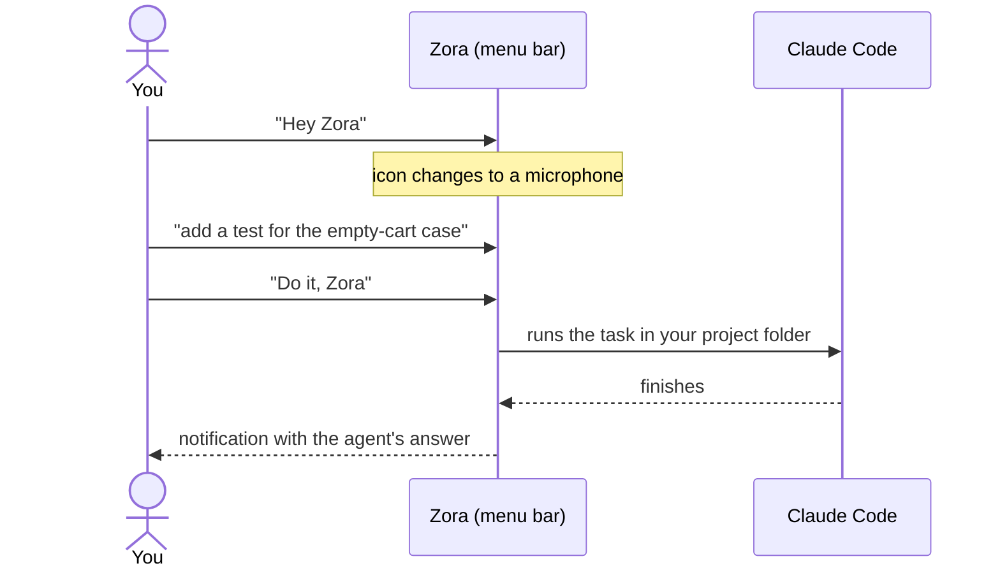

# Zora

Zora lets you hand a task to your coding agent by voice, in the middle of a conversation, without touching the
keyboard. Say **"Hey Zora"**, say the task, then say **"Do it, Zora"**. Zora sends what you said in between to
Claude Code (or another agent you choose), and a notification tells you when it's done.

> "Hey Zora, add a test for the empty-cart case in the checkout service. Do it, Zora."

## Why

You're on a call, at a whiteboard, or thinking out loud, and you hit something you want done: a test, a fix, a quick
investigation. Switching to the keyboard breaks the flow, and by the time you've typed it out the thought has moved
on. With Zora you say the task out loud, keep talking, and the agent works in the background. Zora never talks back,
so it doesn't interrupt anyone.

Zora also keeps a short running transcript of what it hears, so you can look back at what was just said.

## How it works



Zora listens all the time, but only acts on what you say between "Hey Zora" and "Do it, Zora". Everything else goes
into the transcript and nowhere else.

## What you'll see in the menu bar

| Icon | Meaning |
|---|---|
| Waveform | Listening for "Hey Zora" |
| Microphone | Heard "Hey Zora", waiting for "Do it, Zora" |
| Hourglass | Your agent is working on the task |
| Check mark | Done. The notification shows the agent's answer |
| Warning triangle | The task failed or was dropped |
| Crossed-out microphone | Paused. The microphone is off |
| Gear with a cross | Zora needs setup and isn't listening. The menu says what's wrong, and **Settings…** fixes most of it |

Click the icon for the menu:

- **Pause Listening** turns Zora's microphone off within a second, and nothing is heard or saved until you choose
  **Resume Listening**. The orange microphone dot in the macOS menu bar goes away too, unless another app is using
  the microphone. A pause stays in force across restarts. **Pause for 1 Hour** resumes on its own.
- **Settings…** changes the names Zora answers to and the project folder your agent works in.
- The last few results are listed, so you can read an answer after the notification has gone.

Short sounds play too: a tick when Zora hears its name, a pop when the task starts, a chime when it's done.

## Install (macOS)

For now, Zora is built from source. You need:

- A Mac with Apple Silicon running macOS 26
- Xcode 26 and Rust 1.89 or later
- An "Apple Development" signing certificate. Xcode creates one for free with any Apple ID (Xcode → Settings →
  Accounts). It lets macOS remember the microphone permission across rebuilds.
- [Claude Code](https://docs.anthropic.com/en/docs/claude-code), installed and logged in

Then:

```bash
git clone https://github.com/laszukdawid/zora && cd zora
packaging/macos/bundle.sh --install                     # builds Zora.app into ~/Applications
~/Applications/Zora.app/Contents/MacOS/zora setup       # permissions, speech model, project folder
```

`zora setup` asks for microphone and notification access and downloads Apple's on-device speech model. If no project
folder is set yet, it asks which folder your agent should work in. You can also pass one with
`--project ~/code/my-app`.

Try it first in dry-run mode, where tasks are shown in a notification but not run. Press Ctrl-C to stop:

```bash
~/Applications/Zora.app/Contents/MacOS/zora run --dry-run
```

When you're happy with it, start Zora for real, now and at every login:

```bash
~/Applications/Zora.app/Contents/MacOS/zora install
```

## Everyday use

### Give a task

"Hey Zora, *the task*. Do it, Zora." You can also end with "Zora, do it". Pauses while you speak are fine: you have
up to three minutes, with gaps of up to 30 seconds.

### Change your mind

Before you say "Do it", say "Never mind, Zora", "Stop it, Zora" or "Cancel, Zora". Zora drops the task and sends
nothing. (What you said still appears in the transcript.)

### Stop a running task

Say "Stop it, Zora" while the agent is working. Zora stops the most recently started task, and the notification says
so.

### Use a different name

Zora also answers to "Nova" out of the box. In **Settings…** you can add any one-word name of at least three letters
that you find easy to say ("Jarvis", "Echo"), and remove the ones you don't want. After that, "Hey Jarvis … Do it,
Jarvis" works. Changes apply within a second.

### Read the transcript

Zora keeps about the last 4 hours of what it heard, as text:

```bash
~/Applications/Zora.app/Contents/MacOS/zorad transcript --since 30m
```

### Show tasks on the ACDC board

If you use the [ACDC](https://github.com/osano/acdc) task board, Zora can put each voice task on it and move it to
review or blocked when the agent finishes. The board's Zora tab also shows recent tasks and transcript lines. See
[docs/development.md](docs/development.md#acdc-task-board) to turn it on.

## Privacy and safety

- Speech stays on your Mac. Transcription uses Apple's on-device speech model, and audio is never stored or sent
  anywhere.
- The transcript is a private file on your Mac. Zora removes entries older than 4 hours (you can change that in the
  config).
- Zora itself sends nothing over the network. It hands your task to the agent you configured, and the agent works as
  it does when you use it yourself: Claude Code sends the task, and whatever project files it reads, to Anthropic.
- Pausing turns Zora's microphone off. Anything that still reaches Zora while paused is thrown away, never stored or
  acted on.
- Your dictation app wins. If you use a push-to-talk dictation app (TypeWhisper by default), nothing you dictate can
  trigger a task, and when Zora can't tell whether you're dictating, it runs nothing.
- The agent works in your project folder under Claude Code's own permission rules. Nobody is there to approve a
  prompt, so anything Claude Code would normally ask you about is refused unless your Claude Code settings already
  allow it. To let it edit files, set its permission mode to `acceptEdits` (see
  [docs/development.md](docs/development.md#configuration)). Pick a folder under version control, and review what
  the agent did as you would review a colleague's change. Zora won't start if the agent's settings contain a
  known permission-bypass flag.

## Troubleshooting

| Problem | What to do |
|---|---|
| The icon is a gear with a cross | Open the menu to see what's wrong. A missing project folder is fixed in **Settings…**. Other config problems are listed by `~/Applications/Zora.app/Contents/MacOS/zorad status`. Zora starts listening again by itself once the config is fixed. |
| No icon in the menu bar | Zora isn't running. Check `~/Library/Logs/Zora/zora.log`, then run `~/Applications/Zora.app/Contents/MacOS/zora install` again. |
| The icon never changes when you say "Hey Zora" | Check the icon isn't the crossed-out microphone (paused). Then run `zora status` to check microphone permission and the speech model. |
| "Hey Zora" is heard, but the task never runs | A dictation app may have been listening at the same time, or the task took longer than three minutes. The notification says why it was dropped. |
| Your name is often misheard | Add a second, more distinct name in Settings. Zora already accepts common mishearings ("Zara", "Sora" for "Zora"). |

## Platforms

macOS works today. Linux (Ubuntu, Arch) is next: Zora's core already runs there, but the speech and menu-bar parts
are still to be written. Windows comes after that.

## For developers

How Zora is built, how to run the tests, the full configuration reference, and the plugin protocol are in
[docs/development.md](docs/development.md), [docs/design.md](docs/design.md) and
[docs/protocol.md](docs/protocol.md).
